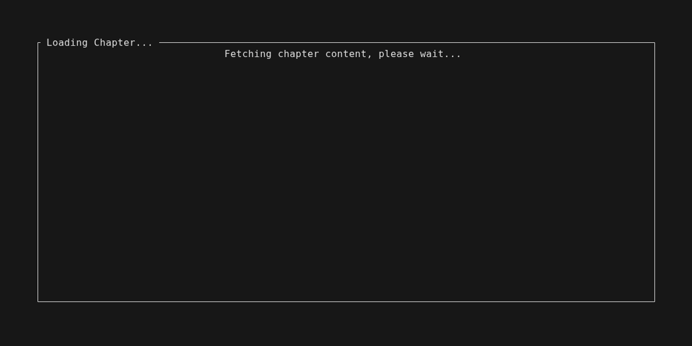

# Scylla Reader

[](https://github.com/MothInBox/scylla-reader/actions/workflows/ci.yml)
[](https://github.com/MothInBox/scylla-reader/blob/main/LICENSE)

Read web novels in your terminal. Scylla scrapes sites through WebAssembly plugins, stores your library in a local database, and keeps reading progress across sessions.


Scylla is in active development. Reading a site requires a plugin for that site; [PLUGINS.md](docs/PLUGINS.md) explains where to get one.

## Contents

- [Quickstart](#quickstart)
- [Installation](#installation)
- [Usage](#usage)
- [Documentation](#documentation)
- [FAQ](#faq)
- [Roadmap](#roadmap)
- [Contributing](#contributing)
- [License](#license)

## Quickstart

```sh
nix run github:MothInBox/scylla-reader
```

1. Press `i`, paste a book URL, and submit with `Ctrl+S`.
2. The server scrapes the book in the background. Job progress shows in the Jobs screen (`8`).
3. Press `Enter` on the book, pick a reading session, and move through chapters with `>` and `<`. From anywhere, `2` opens the most recent session directly.

The reader starts its own server when one is not already running, so one command runs the whole program.

## Installation

### Nix (recommended)

Run once without installing:

```sh
nix run github:MothInBox/scylla-reader
```

Add to your shell temporarily:

```sh
nix shell github:MothInBox/scylla-reader
```

Declaratively, add the flake input:

```nix
scylla-reader = {
    url = "github:MothInBox/scylla-reader";
    inputs.nixpkgs.follows = "nixpkgs";
};
```

Pass `scylla-reader` as a special arg to home-manager and add `scylla-reader.packages.${pkgs.system}.default` to `home.packages`.

### Cargo

You need a Rust stable toolchain (rustup is the simplest way to install one) plus development headers for SSL and curl:

```sh
# Ubuntu/Debian
sudo apt install build-essential pkg-config libssl-dev libcurl4-openssl-dev

# Fedora
sudo dnf groupinstall "Development Tools" && sudo dnf install pkg-config openssl-dev libcurl-devel

# Arch
sudo pacman -S base-devel pkg-config openssl curl

# macOS
brew install openssl curl pkg-config
```

Then build:

```sh
git clone https://github.com/MothInBox/scylla-reader.git
cd scylla-reader
cargo install --path scylla-reader --path scylla-server
```

Both binaries are required; the reader launches the server itself.

The first build takes several minutes. Scylla targets Linux and macOS; Windows is untested. The maintainer develops on Nix and does not exercise the Cargo path regularly, so treat these steps as best-effort and open an issue when they drift.

## Usage



### Reading

Two reader modes: page through text with `→` and `←`, or scroll continuously with `↑` and `↓`. Named sessions keep separate positions in the same book, and progress saves as you go.

### Search

Open the command palette with `:` and choose AI Search, then type a query. Results blend keyword and semantic matching and score 0 to 100. `Enter` on a ranked book lists its top chapters without a round trip, `g` switches between ranked books and grouped chapters, and `.` / `,` cycle the genre. The first search downloads the models (~224MB), so it takes a moment; a fresh library shows a hint instead of an error.

### Jobs

The Jobs screen (`8`) shows scraping, chapter fetch, cover, embedding, and plugin work. Cancel or retry anything with `c` and `r`, and size the worker pool with `+` and `-`.

## Documentation

- [docs/ARCHITECTURE.md](docs/ARCHITECTURE.md): crates, the client-server split, data flow
- [docs/KEYBINDINGS.md](docs/KEYBINDINGS.md): every key by screen
- [docs/PLUGINS.md](docs/PLUGINS.md): install, configure, and write plugins
- [docs/CONFIGURATION.md](docs/CONFIGURATION.md): settings, storage paths, config files

## FAQ

### Where is my data stored?

The database, settings, and plugins all live under the standard config and data directories on your system (`~/.config/…` and `~/.local/share/…`). [CONFIGURATION.md](docs/CONFIGURATION.md) lists every path.

### How do I add a site that is not supported yet?

Install a plugin for the site. The command palette (`:`) installs from a GitHub release, or drop a `plugin-<domain>.wasm` file into the plugins directory yourself.

## Roadmap

- **Plugin explore feed**: browse and discover books in-app. Plugins expose a `search(query)` function; the TUI renders results and runs `scrape_book` on the one you pick.
- **Manual plugin selection**: a conflict warning when several plugins match a domain, and a picker for choosing the source.
- **Design unification**: consistent spacing, hierarchy, and component styles across pages and modals.
- **Per-plugin scraping delay**: move the rate limit from one global setting to a per-domain delay.

## Contributing

See [CONTRIBUTING.md](CONTRIBUTING.md) for the dev shell, the git flow, and the checks a change must pass.

## License

GPL-3.0. See [LICENSE](LICENSE).
